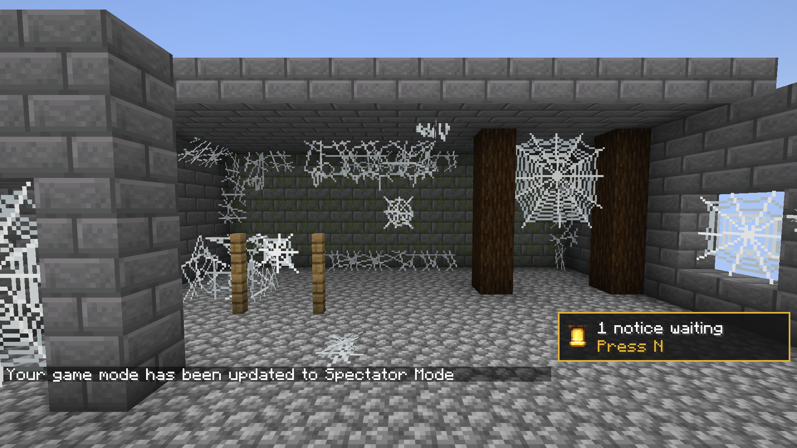
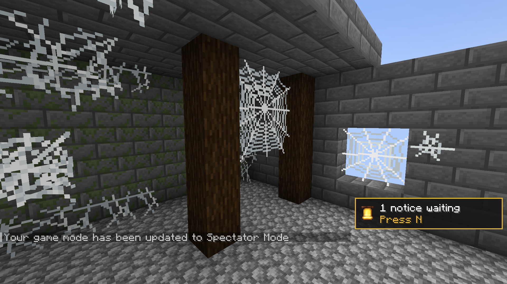

# Better Webs

A Fabric mod that strings cobwebs between whatever holds them, and gives spiders a use for their silk: now and then one throws a web at what it is hunting, or spins a new one somewhere dark.

## Webs That Hang Where They Are

Vanilla draws every cobweb as the same cross, floating in the middle of its block whatever is round it. Here a web looks at what holds it, a wall, a floor, a ceiling, a fence post or more web, and is drawn strung between those.

- Webs filling an open space up to four blocks a side, a doorway, a window, the gap between two pillars or fence posts, are one orb web spun across the whole of it.
- A web tucked into a corner, between two walls or a wall and the floor or ceiling, is a sheet across the corner, tied to both. A run of them along the foot of a wall is one sheet.
- Other webs side by side, against a wall or clumped into a den, are one tangled sheet of silk, every thread carried on unbroken from block to block, never the same twice, so a cluster of them reads as one web, not a stack of crosses.
- A web hung from above with nothing under it frays at its lower edge into loose strands, each its own length.
- A web held only from above is that frayed edge: loose strands carrying on the web or ceiling over it.
- A web held only by the floor or one wall is a small clump of silk standing out from it.
- A web held by nothing keeps vanilla's cross.

## Spiders

Now and then a spider chasing something five to fourteen blocks off stops and rears back: front legs up, abdomen tipped high, silk gathering at its spinnerets with a hiss. The rear is the warning, half a second to step aside. Then its abdomen flicks forward and a ball of web flies, trailing a strand of silk back to the spider. Where it lands it bursts and leaves a cobweb, at your feet if it hits you, and the web comes apart by itself five seconds later. It drops no string. A spider throws at most once every ten to twenty seconds, and not at anything already caught in a web.

Now and then a spider with nothing to hunt goes and spins a web somewhere dark it can string one across: beside a web already there when it can, so a den fills in, or else into a corner. It turns its back to the spot and works for two seconds, abdomen swaying, strands of silk shooting from it to each thing the web will hang from, and then the web is there. It stops once there are eight webs within four blocks, so a cave gets webbed, not filled. It never spins round anyone, itself included.

Cave spiders do both.

Spiders also come in sizes now. Most are a good deal smaller than vanilla's, anywhere from three fifths to nine tenths of the size and mostly about three quarters, so no two look quite alike. Cave spiders stay the smaller kind, from three quarters of their old size to the whole of it. About one spider in twenty five is a big one, a quarter again to over half again as big as a vanilla spider: it walks at three quarters of the pace and takes two and a half times the hits to kill. A spider keeps the size it was given.

With the `mob_griefing` game rule off, spiders spin nothing, and a thrown web leaves no block: it slows whoever it hits for three seconds instead.

## Pandorical

Better Webs runs server-side, and Pandorical is required there: the server will not load this mod without it. The spiders are the server's alone, so everyone meets them; a thrown web flies as a snowball wearing a cobweb, so every client sees it.

**The Pandorical mod must be installed client-side** to see the strung webs and the spiders rearing and spinning. Without it a client sees vanilla's cobwebs and a spider that throws without moving, though the silk, the strands and the sounds are the same for everyone: no new blocks are added.

## Development

The map of the source and the art pipeline are in [DEVELOPMENT.md](DEVELOPMENT.md).

## License

MIT, see [LICENSE](LICENSE).
